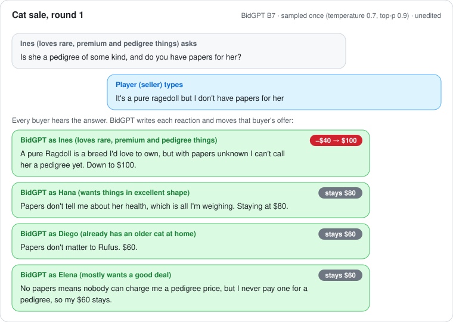
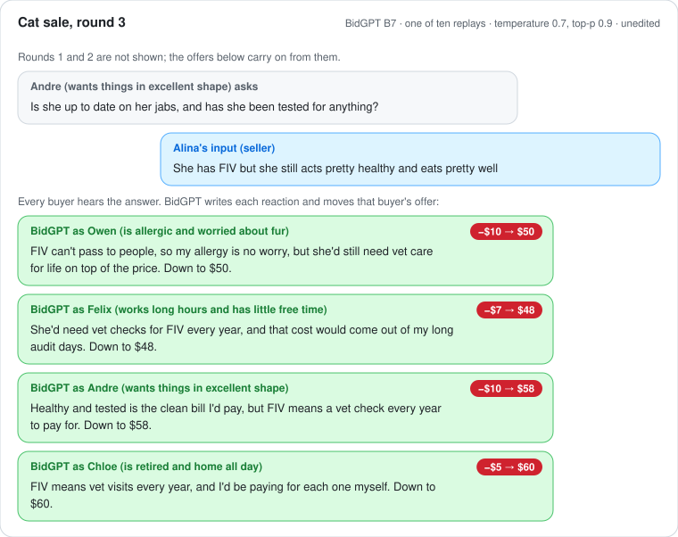
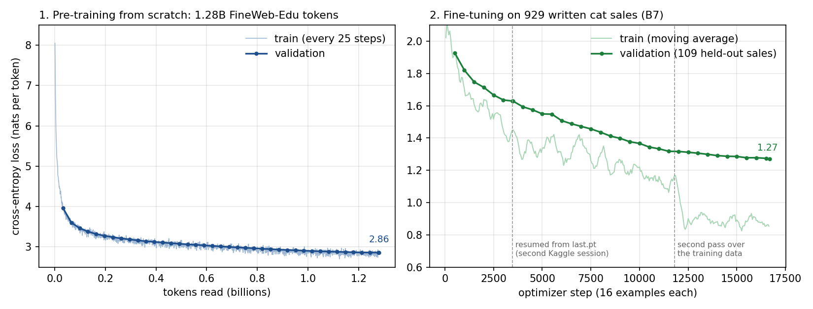

# BidGPT

[](https://github.com/alina0607/BidGPT/actions/workflows/ci.yml)

> A GPT trained from scratch to play a room of buyers: each one asks about the cat for sale, hears every answer,
> moves their offer for reasons from their own life, and says why.

**BidGPT** is the buyer model of **Sell Anything**, the game below.

- **Trained from scratch:** a 71M-parameter Llama-style GPT with its own SentencePiece tokenizer, pre-training on FineWeb-Edu, then supervised
  fine-tuning on written cat sales. No pretrained weights, no API.
- **One model, many buyers:** every buyer has a persona card (allergic, two dogs at home, works long hours, breeds
  show cats, ...). The same seller answer, such as "barely sheds, but she isn't spayed yet", moves each buyer a
  different way, and each buyer explains the move in their own words. The model also plays the seller, who accepts,
  counters or refuses each final offer.
- **Improved only through data and training,** and measured on held-out sales. Example: when the training data for
  "sheds very little" went from 0 to 15 reactions, the allergic buyer went from lowering their offer 98% of the time
  to raising it 99% of the time.
- **Training data (version B7):** 929 sales, 133,564 examples over seven tasks (open, ask, react, imagine, answer,
  decide, reply).
- **Where the sales come from:** larger LLMs wrote them as teachers (Qwen2.5-32B-Instruct, Claude, ChatGPT and Muse),
  and every line was checked against the price engine's rules. BidGPT learns only from that text, never from a
  teacher's weights.

"GPT" here is the architecture (a decoder-only transformer, trained from scratch); it is not based on OpenAI's
models.

## What BidGPT says

Two rounds from two cat sales. The seller's answers are the author's (Alina's) own input, typed while playing the
seller (typos included). Everything in green is BidGPT B7: one model writes every buyer, each from their own persona
card, with every reaction and offer. Each sale was replayed ten times at the game's settings (temperature 0.7,
top-p 0.9); the two rounds below were picked from those replays for fluency, and the lines are shown as the model
wrote them, except one name in square brackets. The measured results further down are not picked.



Only the collector lowers her offer; the other three say why papers do not matter to them, and the model fixes the
typo ("ragedoll" → Ragdoll). Diego named his old cat, Gus, in his opening line, and the model wrote "Papers don't
matter to Gus." The name is replaced with [my old cat] here because the openings are not shown.



"Acts pretty healthy" does not cancel FIV: all four buyers lower for the lifelong vet bills, each in their own terms.
The allergic buyer adds that FIV cannot pass to people, so it has nothing to do with his allergy. B6, the previous
version, got this round right 3 times in 40.

### One small word changes the answer

The same buyer, the same prompt and the same sampling seed; only the seller's answer changes. Three answers are
Alina's own input from play; two are test answers swapped in for her answer, to see whether the model reads the small
word. B5 and B6 show the move they make; B7 shows its move and the reaction it writes.

| Buyer's question → seller's answer | Buyer reacting | Should | B5 | B6 | B7 |
|---|---|---|---|---|---|
| **Owen asks:** How much fur does she leave around? I've read that neutering can lower the allergen a cat makes.<br>**Test answer:** She barely sheds. | Owen (allergic) | raise | lower | lower | **raise** \$75 → \$85: *Barely shedding means less fur on my clothes and makeup in my dresser, though no cat is free of allergen, so I'd still sit with her first.* |
| **Andre asks:** Is she up to date on her jabs, and has she been tested for anything?<br>**Alina's input:** She has FIV but she still acts pretty healthy and eats pretty well | Owen (allergic) | lower: lifelong vet bills | stay | stay | **lower** \$60 → \$50: *FIV can't reach people, yet her checkups for life would be my bill for as long as she lives.* |
| **Felix asks:** Is she neutered yet? I'd have to book and pay for that myself.<br>**Alina's input:** Just told you that she is intact since she is just 2 months old. It's too young for the surgery | Felix (works long hours) | lower: a spay bill | raise | raise | **lower** \$62 → \$55: *Intact means a vet bill I'd have to fit around my tram shifts and pay for myself.* |
| **Andre asks:** Is she up to date on her jabs, and has she been tested for anything?<br>**Test answer:** She tested negative for FIV. | Andre (wants excellent health) | stay: no cat at home to protect | raise | raise | **stay** \$73: *Tested negative is the health I'd expect before she comes home, so I'll ask about that and keep \$73.* |
| **Hana asks:** She's ten. Has she had her kitten shots?<br>**Alina's input:** I'm not sure about that | Hana (wants up-to-date shots) | stay and ask a vet | lower | lower | **lower** \$80 → \$75 ❌: *Not sure about her kitten shots is a gap I'd fill in a vet check before I'd call her healthy.* |

The last row is a case B7 still gets wrong. In every row the written move agrees with the model's most likely move,
read from its probabilities before it writes a word.

**How B7 learned "barely".** B5 and B6 did not: told *She barely sheds*, the allergic buyer lowered the offer, as if
the cat shed a lot. Their training data explains why. An allergic buyer heard "sheds a lot" 159 times and lowered 153
times, but heard "barely" only 6 times, "hardly" twice and "doesn't shed much" 5 times. Seeing "shed" was enough to
guess "lower" almost every time, so the model never had to read the small word in front of it.

B7's data adds 85 new written sales (929 in all) aimed at the phrasings the earlier models misread. Each phrasing is
written in groups of sales on the same topic with opposite meanings (*barely sheds* / *sheds a lot* / *don't know*),
for every kind of buyer it concerns, and some answers put a good and a bad fact in one sentence:

| Seller's answer (training data, B7) | Allergic buyer's reaction |
|---|---|
| She barely sheds. | Hearing she barely sheds, there'd be less fur for my chest to fight, though no cat is free of the allergen and I'd sit with her first. Up to \$80. |
| barely sheds, but she isnt spayed yet. | Barely shedding means less loose fur in my front room, which my allergy welcomes, though the spay is still a bill I'd pay. Down to \$65. |

| Allergic buyer's reactions in the training data | B6 | B7 |
|---|---|---|
| "barely" | 6 | 24 |
| "hardly" | 2 | 19 |
| "doesn't shed much" | 5 | 23 |
| "not much" | 0 | 17 |

The same batch covers the other phrasings in the table above: FIV in a player's words ("has FIV", "fiv+") with and
without "but she seems healthy", "not really, only with a dog", "I'm not sure", and "intact, she's only 2 months".
B7 learned the phrasings it was shown (the probe answer *She barely sheds.* is itself one of the new training
answers); it did not learn negation in general. Six phrasings were kept out of the
training data on purpose (*ain't*, *no longer*, *rarely*, *seldom*, *even though*, *there's no denying*), and on the
trap test's pairs with them B7 gets 6 of 48 right, against 3 for B6.

**How B7 learned that Felix asked about the spay.** Felix asked whether she is neutered, and Alina's answer added a
trap: the cat's age. B5 and B6 took the age as the point and raised (B5: *A kitten of 2 months has her whole life
ahead, which is exactly the hours I'm away fixing trams.*). The direction itself was in their data: buyers who work
long hours lowered for "intact" plus an age in months 28 times out of 29. What was missing was the way a player says
it: of 15 seller answers with "intact" and an age in months, only 5 were in a player's style. B7's data has 29, 19 of
them in a player's style, and pairs them with answers that give the age alone, where this buyer keeps the offer
(B6: 19 such reactions; B7: 39, 36 of them keeping it):

| Seller's answer (training data, B7) | Buyer who works long hours |
|---|---|
| shes intact, only 2 months. | Intact at two months means a spay I'd have to book and pay for around nights at the office till nine. Down to \$70. |
| shes 2 months old. | Two months is her age, but an age tells me nothing about how many vet visits she'd need around my piano work, so I hold at \$70. |
| She's 2 years old. | Being two years old doesn't shorten my twelve hour days or change how she copes alone, so \$65 holds. |

The age is in both of the first two answers, so only "intact" can decide the move. B7 now answers the spay question
and lets the age go. It has not fully learned the second half: told only *She's 2 years old.*, B7's Felix still lowers
(*A cat of 2 years means more vet visits and more trips to the vet*), and told only *She's only 2 months old.* one
round after hearing she is intact, he lowers again for the same spay bill.

### Training



1. **Pre-training** from random weights on 1.28B FineWeb-Edu tokens (39,062 steps of 64 × 512 tokens, one A100):
   validation loss 2.86.
2. **Supervised fine-tuning (B7)** on 929 written cat sales, two epochs (16,695 steps of 16 examples, one Kaggle T4,
   in two sessions): validation loss on 109 held-out sales 1.93 → 1.27. Training loss drops at the start of the
   second pass over the data, while validation loss keeps falling.

### Measured, not picked

| Test | B5 | B6 | B7 |
|---|---|---|---|
| Two play-session sales replayed 10 times: offer moved the right way | 57% | 71% | **91%** |
| Swapped-answer probes (47 answers): most likely move right | 23 | 34 | **42** |
| Held-out sales (17 sales, 1,513 reactions): same direction as the written buyer | — | 79.4% | **81.8%** (paired z = 2.66) |
| Trap test (229 answer pairs with opposite meanings): both right | 21 | 47 | 43 |

The B7 data batch was written to fix what the two play-session sales exposed, so those two rows show that the fix
worked; the held-out sales and the trap test are the independent checks. On them B7 gains 2.4 points and does not
improve on the trap test. Known weaknesses of B7: a buyer can lower twice for the same bill, a cat's age alone
sometimes lowers an offer, and some opening lines do not make sense.

## Sell Anything: the game around it

> Draw anything. Try to sell it. A room of AI buyers decides what it's worth.


**Sell Anything** is a game built end-to-end from scratch:

- a **custom C++ engine** with swappable rendering backends (OpenGL, DigiPen's DGL, headless),
- a **sketch classifier** trained on all 345 classes of Google's [Quick, Draw!](https://github.com/googlecreativelab/quickdraw-dataset),
- a **price engine and host** that run a 3–5 buyer negotiation for any of the 259 sellable items,
- a **small GPT trained from scratch** (tokenizer → pre-training → SFT) to speak and judge for the buyers.

| Draw | Confirm | Negotiate | Sell |
|---|---|---|---|
|  |  |  |  |

> 🚧 **Status:** a full round is playable (draw → classify → negotiate → sell). Buyers speak through
> the trained model, with the price engine as a guardrail: the engine owns every number, and a model
> line that disagrees with it (or garbles the question) falls back to a phrase pool. The character
> art is placeholder, in the final format. See the [plan](docs/plan.md) and [roadmap](docs/roadmap.md).

## How a round plays

Character controls: **WASD / arrow keys** move, **Space** jumps, **Shift** slides in the facing direction,
**J** performs a one-shot spinning kick, and **K** casts a heart light wave from an open palm.
The wave travels in the facing direction and fades out (no enemy/damage system yet). Jump height is twice
the previous height. Click a text field to type; the answer field also accepts Enter to focus.
Gameplay keys are disabled while typing. Click outside or press Esc to return to movement.

1. **Draw** with the mouse. The game sends the strokes to the ML service.
2. **Confirm**: the classifier shows its top 3 guesses (on 172,500 drawings it never trained on: 72.4% top-1, 87.6% top-3 across 345 classes); the player picks one.
3. **Negotiate**: 3–5 buyers, each with their own traits and budget, take turns asking about the
   item. Click an answer or type your own ("shes like 12"); a typed answer is matched to the closest
   option by [explainable rules](docs/buyer-ai.md#10-typed-answers), and the game shows what it was
   taken as. *Everyone* hears every answer and moves their offer: a big dog is a plus for the hiker and
   a deal-breaker for the buyer in a small apartment. Buyers who lose interest walk away; the rest
   outbid each other.
4. **Sell** to whoever offers most, or keep it.

Try to sell a rainbow, the sun or your elbow and every buyer refuses. A tiger or a rifle does sell,
black-market style: buyers with kids, retirees and apartment dwellers walk away at once, and the
answer without papers is the cheap one.

## The first buyer model (v1 to v4, any drawn item)

Before BidGPT, a 12.9M-parameter GPT (pre-trained on 100M FineWeb-Edu tokens, then fine-tuned on dialogue the price
engine generates) writes what buyers say and judges how each answer moves their interest. Every
version was scored on the same test questions, including 33 items it never saw in training:

| Version | What changed | Held-out items: question on topic | Held-out items: interest change exact | Lines used in play (held-out items) |
|---|---|---|---|---|
| v1 | — | 29% | 70% | 45%\* |
| v2 | 30% of training items renamed to made-up words ([D16](docs/plan.md)) | 41% | 70% | 53%\* |
| v3 | the engine's question goes in the prompt ([D18](docs/plan.md)) | 77% | 70% | 67% |
| v4 | the model writes `{item}`, the engine fills in the name ([D19](docs/plan.md)) | **91%** | 71% | **76%** |

Test sets of about 700 questions and 1,750 reactions per column (±2–4 points); "used in play" is
30 autoplayed rounds. \*Measured before a guardrail fix that made short questions stricter.

For comparison, guessing the most common interest change scores 42% on held-out items, and on
items it has seen the model gets 97–98% of interest changes exactly right, against 64% for a baseline
that looks only at the answer and ignores who the buyer is. The rest of the story, including the
two hypotheses that turned out wrong, is in the [devlog](docs/devlog/2026-10-03.md).

## Architecture

```
┌──────────── C++ game ────────────┐                ┌──────────── Python ML service ─────────────┐
│ engine: loop, scenes, text,      │   NDJSON over  │ sketch: rasterize strokes like Quick, Draw!, │
│         OpenGL / DGL / null      │◀──────────────▶│         CNN (345 classes)                    │
│ game:   canvas, confirm, round UI│  127.0.0.1:5555│ buyers: item schemas, price engine, host     │
└──────────────────────────────────┘                │ llm:    tokenizer, GPT, pre-training, SFT    │
                                                    └──────────────────────────────────────────────┘
```

| Component | Path | Highlights |
|---|---|---|
| Engine | [`engine/`](engine) | Backend interface selectable at run time; batched OpenGL draws; bitmap-font text; textures, sprite sheets and animation on every backend |
| Game | [`game/`](game) | Async ML client, scenes, animated buyers that react to every answer, `--autoplay` for demos, screenshots and the end-to-end test |
| Sketch classifier | [`ml/sellanything_ml/sketch/`](ml/sellanything_ml/sketch) → moving to [sketch-recognition-from-scratch](https://github.com/alina0607/sketch-recognition-from-scratch) | Reproduces Quick, Draw!'s preprocessing; pixel correlation **0.996** with the official bitmaps |
| Buyers | [`ml/sellanything_ml/buyers/`](ml/sellanything_ml/buyers) | 259 item schemas, 11 buyer traits, valuation, bidding, host — [spec](docs/buyer-ai.md) |
| Buyer model | [`ml/sellanything_ml/llm/`](ml/sellanything_ml/llm) | SentencePiece (8k), Llama-style GPT (RMSNorm, RoPE, SwiGLU, GQA, KV cache) |
| DGL on OpenGL | [`compat/`](compat) | Runs programs written for DigiPen's DGL on macOS/Linux — including this game's own DGL backend, so it is built and run off Windows too |

Design decisions and their reasons are recorded in [`docs/plan.md`](docs/plan.md).

## Running

**Quickest:** demo mode needs no model download. It builds the game if needed, starts a lightweight
local service, and opens the game (closing the game stops the service again):

```bash
python3 scripts/play.py --demo
```

Use `python3 scripts/play.py` after installing the trained-model dependencies; add `--autoplay` to
either command to watch it play a round by itself.

On macOS, `python3 scripts/make_mac_app.py` makes `build/Sell Anything.app`: double-click it, or
drag it to the Dock. The parts it runs, separately:

**ML service** (Python ≥ 3.10):

```bash
cd ml
uv sync --extra train                   # environment from uv.lock, with the dev tools
uv run python -m sellanything_ml.server # 127.0.0.1:5555
```

The classifier checkpoint comes from `python -m sellanything_ml.sketch.train --per-class 15000 --epochs 12`
(about 4 hours on an Apple M-series GPU when plugged in, 20 minutes an epoch; the default `--per-class 6000 --epochs 15` takes about 1.5 hours and scores 0.8 points lower); model weights will be published on Hugging Face.

**Game** (CMake ≥ 3.24, C++20; GLFW, nlohmann/json, stb and font8x8 are fetched automatically):

```bash
cmake -S . -B build -DCMAKE_BUILD_TYPE=Release
cmake --build build
./build/game/sell_anything                # --autoplay plays a round by itself
./build/game/sell_anything --market       # the painted market and its characters instead of the studio look
./build/game/sell_anything --buy          # buy a cat: the buyer GPT B6 is the seller and the other buyers
./build/game/sell_anything --compare b4f9,b5   # the same cat sale to two buyer models, side by side
```

"Buy a cat" (on the drawing screen, or `--buy`) turns the sale around: the player is the last buyer in the row,
opens with an offer, asks the seller one question and reacts to every answer; at the end the seller decides on each
final offer (accept, counter or refuse). It needs `ml/runs/sft_b6/best.pt` (prompt format 10) or
`ml/runs/sft_b5/best.pt` (format 8).

The renderer is chosen at run time (`--backend opengl | dgl | null`); Windows/DGL setup is in
[`docs/backends.md`](docs/backends.md).

**Without the game**, a round can be played in the terminal:

```bash
cd ml && python -m sellanything_ml.play dog
```

**Development** (in `ml/`, managed with [uv](https://docs.astral.sh/uv/); `uv sync` installs the
dev tools from `uv.lock`):

```bash
uv sync --extra train
uv run ruff check . ../scripts   # lint
uv run mypy                      # type check (the files listed in pyproject.toml, in batches)
uv run pytest                    # tests
uv run pre-commit install        # run ruff and mypy before every commit
```

GitHub Actions runs the engine build on three systems and the same three ml checks on every
push to `main` and `dev` and on every pull request ([`.github/workflows/ci.yml`](.github/workflows/ci.yml)).

**Checks**: `python scripts/check.py` runs every stage, cheapest first: lint, the Python tests,
the C++ build, engine tests, an end-to-end round (the real game, headless, against the real server),
data freshness, a model regression check and a static-analysis gate on new findings. `--quick` runs
the first four. A stage that can't run on this machine says SKIP, not PASS. See
[docs/quality.md](docs/quality.md).

## Data

| Dataset | Licence | Used for |
|---|---|---|
| [Quick, Draw!](https://github.com/googlecreativelab/quickdraw-dataset) | CC BY 4.0 | Sketch classifier, item list |
| [FineWeb-Edu](https://huggingface.co/datasets/HuggingFaceFW/fineweb-edu) (via `karpathy/fineweb-edu-100b-shuffle`) | ODC-By | Tokenizer and GPT pre-training (201M tokens) |
| Buyer dialogues | generated here | Buyer SFT: 166k examples (112k for training) from simulated rounds, labels from the price engine |

## Acknowledgements

- [nanoGPT](https://github.com/karpathy/nanoGPT) and [nanochat](https://github.com/karpathy/nanochat) by Andrej Karpathy
- [MiniMind](https://github.com/jingyaogong/minimind) by jingyaogong
- [Quick, Draw!](https://quickdraw.withgoogle.com/data) by Google Creative Lab
- [font8x8](https://github.com/dhepper/font8x8) by Daniel Hepper (public domain)

## License

[MIT](LICENSE)
